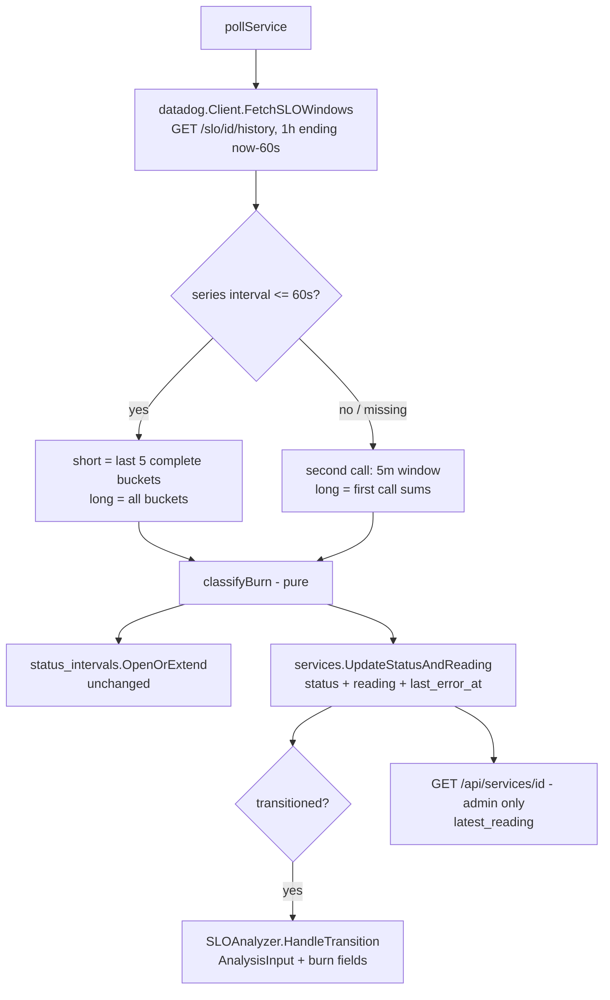

# Poller Burn-Rate Classification Design

**Spec**: `.specs/features/poller-burn-rate-classification/spec.md`
**Context**: `.specs/features/poller-burn-rate-classification/context.md`
**Status**: Approved (2026-10-22)

---

## Replay calibration (BURN-12)

Run 2026-10-22 against a real Datadog production account, read-only.

- **Data**: 7 days (2026-10-15 to 2026-10-22), 60s buckets of each SLO's own `trace.*.request.hits/errors` queries, replayed as 120s poll cycles with windows ending 60s before the cycle (the poller's real cadence and lag).
- **Sample**: 8 metric-based SLOs at 99.5%/30d: a high-traffic API gateway with ~1% baseline error rate, a high-traffic healthy service, three mid-traffic services (one with a real multi-hour incident, one breached by chronic low-rate errors), one low-traffic service, two low-traffic flow SLOs.
- **Reference**: a proxy of Datadog's multi-window `slo alert` monitor (1h/5m, 14.4x critical / 7.2x warning, no minimum errors), evaluated on the same cycles.
- **Raw per-SLO tables** stay out of this repo (they identify a customer's services and incidents). Aggregates below.

| Classifier | False episodes (status ≠ operational while the monitor proxy is OK) | Minutes stuck after errors stop | Recovery vs proxy | Real incidents caught |
| --- | --- | --- | --- | --- |
| Current (5m SLI vs 30d target, `breachBound`, hysteresis, carry-forward) | 102 across 6 SLOs; the gateway alone spends 714 min/week non-operational with normal burn rate | gateway mean 291 min, max 982 min (16h) | hours late on the gateway; missed every episode of the chronic-error service | all large ones, late |
| New (this design: min errors 3, grace 15 min, no hysteresis) | 0 on every SLO | 0 | same cycle as proxy | all, on the first cycle |

Constant sweep:

- **Minimum short-window errors**: `1`/`2` let through noise on a mid-traffic service (2 errors in ~25 requests); `5` delays/misses small real incidents (4 errors in 34 requests, 6 in 13). **3** chosen. Only episodes with 1-2 errors in the short window are suppressed vs the proxy, which is the intended effect.
- **Zero-traffic grace (10/15/30 min)**: no difference in production data, because production services always exit an incident through a window with traffic and no errors. The grace only acts on low-traffic environments (staging). **15 min** kept as decided; not validated by this replay.
- **Hysteresis (`breachHysteresisCycles = 2`)**: no false-positive reduction (already 0 without it), +2 min outage detection, and its `breachStreak` lives in memory (lost on restart / HA handover). **Removed.**
- **Recovery hold** (keep `degraded`/`outage` N minutes after the short window clears): on the gateway, 0 min = 30 episodes / 76 transitions per week; 10 min = 16 / 34; 20 min = 5 / 12, at the cost of slower recovery (spec goal ≤ ~8 min). The proxy itself has 76 transitions on the gateway, so 0 matches Datadog exactly. Default **0** (see Open decision).

---

## Architecture Overview

One `/history` call per service per cycle (unchanged count) over the long window; the connector splits it into short/long aggregates from the per-interval series; a pure classifier decides the status; the poller persists status + latest reading in one place; analyzer hooks are unchanged except for richer `AnalysisInput`.



---

## Code Reuse Analysis

### Existing Components to Leverage

| Component | Location | How to Use |
| --- | --- | --- |
| `FetchSLOStatus` / `sloHistoryResponse` | `internal/connectors/datadog/client.go:168,202` | Extend the response struct with `series.times`, `series.interval`, `numerator.values`, `denominator.values` (all floats; see the float-decode lesson at line 176). Keep threshold pick logic. |
| `FetchWithRetry` | `internal/poller/retry.go` | Unchanged; wraps the new fetch. |
| `recentWindowLag` | `internal/poller/poller.go:40` | Kept (60s aggregation lag). |
| `classifyByState` / `normalizeStatus` | `internal/poller/poller.go` | Kept only for `Target <= 0` and monitor-based SLOs (no series). `normalizeStatus` stops being reachable for `no_data` on metric SLOs. |
| `OpenOrExtend`, `UpdateStatus` | `internal/db` | `OpenOrExtend` unchanged. `UpdateStatus` gains a sibling that also writes the reading. |
| `SLOAnalyzer.HandleTransition`, `buildAnalysisInput` | `internal/poller/analyzer.go:138` | Same hooks; input gets 4 new fields. |
| `causeSentence` pattern | `internal/llm/prompts.go` | Same "optional extra sentence" approach for burn numbers. |
| `ServicesHandler.Get` detail response | `internal/api/services_handler.go:380,393` | Add `latest_reading` (admin endpoint only). |
| `ServiceDetailDrawer` `Stat` row | `web/src/features/services/ServiceDetailDrawer.tsx:247` | Add reading stats with i18n keys. |
| MSW service detail fixture | `web/src/test/msw/handlers.ts:1898` | Mirror new field exactly. |

### Integration Points

| System | Integration Method |
| --- | --- |
| Datadog | Same endpoint, same call count in the normal path; fallback second call only if the series is coarser than 60s. |
| Postgres | Migration `0052`: nullable columns on `services` (RLS inherited from the table, no new policy). |
| Public status page | Untouched; `latest_reading` is never added to the public response (BURN-16). |

---

## Components

### Connector: `FetchSLOWindows`

- **Purpose**: Return request/error counts for the short and long windows plus target/state from Datadog.
- **Location**: `internal/connectors/datadog/client.go`
- **Interfaces**:
  - `FetchSLOWindows(ctx, sloID string, end time.Time, short, long time.Duration) (SLOWindows, error)`
  - `SLOWindows{Target, Timeframe, State string-equivalent fields; Short, Long WindowCounts; HasSeries bool}`; `WindowCounts{Requests, Errors int64}`
- **Behavior**:
  - Request `from = end - long - 1 bucket` so the partial first bucket can be discarded (replay saw a zero-valued partial first bucket).
  - `errors = denominator - numerator` per bucket, clamped to `[0, denominator]` (BURN-17).
  - Short = sum of the buckets whose start is ≥ `end - short`. If `series.interval > 60s` or the series is absent but `overall` exists, fall back to a second `/history` call for `[end-short, end]` using its `series.denominator.sum`/`numerator.sum`.
  - `HasSeries = false` when Datadog returns no series at all (monitor-based SLO, NB-7) → caller uses `classifyByState`.
  - Log `X-RateLimit-Remaining` at debug and warn when below 10% (rate limit for this endpoint is undocumented [Incerto]).
- **Reuses**: `sloHistoryResponse`, threshold pick, HTTP plumbing. `FetchSLOStatus` is kept for the `/slo/search`-based callers if any remain; the poller stops using it.

### Classifier: `classifyBurn`

- **Purpose**: Pure decision of the new status from window counts, target, previous status and timing.
- **Location**: `internal/poller/burn_rate.go` (new; replaces `breach_threshold.go`)
- **Interfaces**:
  - `burnRate(errors, requests int64, target float64) float64` — `(errors/requests)/(1-target/100)`; `requests == 0` → 0; `target >= 100` → `+Inf` when errors > 0.
  - `classifyBurn(in burnInput) string` with `burnInput{Short, Long WindowCounts; Target float64; Previous string; LastErrorAt *time.Time; LastChangeAt, Now time.Time}`
- **Rules** (in order):
  1. Short requests == 0:
     - Previous `not_configured`: classify from the long window alone (rules 2-4 with long as both windows); long also empty → stay `not_configured` (BURN-10).
     - Previous `outage`/`degraded`: stay until `Now - (LastErrorAt ?? LastChangeAt) ≥ zeroTrafficGrace`, then `operational` (BURN-06).
     - Otherwise stay `operational` (BURN-07).
  2. Long requests == 0 → long burn = short burn (BURN-17).
  3. Short errors ≥ `minShortWindowErrors` AND short ≥ 14.4 AND long ≥ 14.4 → `outage` (BURN-02).
  4. Short errors ≥ `minShortWindowErrors` AND short ≥ 7.2 AND long ≥ 7.2 → `degraded` (BURN-03).
  5. Else `operational` (BURN-04, BURN-05).
- **Constants** (package-level, documented with the replay numbers): `shortWindow = 5m`, `longWindow = 1h`, `outageBurnRate = 14.4`, `degradedBurnRate = 7.2`, `minShortWindowErrors = 3`, `zeroTrafficGrace = 15m`, `recoveryHold = 0`.
- **Removed**: `breachBound`, `breachThresholdSigmas`, `breachHysteresisCycles`, `minRecentWindowRequests`, `recentWindowWidth`, `Poller.breachStreak` (and its tests), with the AD-019 lineage marked superseded.

### Poller: `pollService`

- **Purpose**: Orchestrate fetch → classify → persist → notify.
- **Location**: `internal/poller/poller.go:368`
- **Changes**: `Target <= 0` or `!HasSeries` → `classifyByState` (BURN-09, NB-7). Else `classifyBurn`. `LastErrorAt` = now when short errors > 0, else previous value. Debug log replaces `breach_bound`/`breach_streak` with `short_requests/short_errors/long_requests/long_errors/burn_short/burn_long`. Fetch error contract unchanged (BURN-11).

### Repository: `ServiceRepository.UpdateStatusAndReading`

- **Purpose**: Persist status and latest reading atomically (one `UPDATE`), restart/HA-safe (BURN-13, BURN-17).
- **Location**: `internal/db/service_repository.go`
- **Interfaces**: `UpdateStatusAndReading(ctx, serviceID, status string, r ServiceReading) error`; `ServiceReading{BurnShort, BurnLong float64; ShortErrors, ShortRequests int64; ReadAt time.Time; LastErrorAt *time.Time}`. `Service` struct gains the same fields as pointers. Existing `UpdateStatus` keeps its other callers (manual polling).

### LLM input

- **Location**: `internal/llm/prompts.go`, `internal/poller/analyzer.go:138`
- **Changes**: `AnalysisInput` gains `BurnRateShort`, `BurnRateLong`, `WindowErrors`, `WindowRequests`; `burnSentence(in)` adds one user-prompt sentence (error rate in the last 5 min, how many times faster than the budget allows), only when `WindowRequests > 0`, for outage description, degraded tooltip and closing comment (BURN-15). System prompt tone rules unchanged.

### Admin API + UI

- **API**: service detail response adds `latest_reading: {burn_rate_short, burn_rate_long, window_errors, window_requests, read_at} | null` (BURN-13/14). Public handler untouched; a test asserts the public payload has no such keys (BURN-16).
- **UI**: `ServiceDetailDrawer` adds a "Última leitura" block: error rate (errors/requests, 5 min), burn rate 5m / 1h formatted `12.3x`, reading time relative; empty state when `null` (BURN-14). Keys in `web/src/locales/{pt-BR,en}.json`; `web/src/types/api.ts` + MSW fixture mirrored.

---

## Data Models

### Migration `0052_service_latest_reading`

```sql
ALTER TABLE services
  ADD COLUMN last_burn_rate_short double precision,
  ADD COLUMN last_burn_rate_long  double precision,
  ADD COLUMN last_window_errors   bigint,
  ADD COLUMN last_window_requests bigint,
  ADD COLUMN last_reading_at      timestamptz,
  ADD COLUMN last_error_at        timestamptz;
```

Down migration drops the six columns. All nullable, no backfill: a NULL reading renders the empty state; NULL `last_error_at` falls back to `last_status_change_at` for the grace timer. Existing RLS on `services` covers the new columns.

---

## Error Handling Strategy

| Error Scenario | Handling | User Impact |
| --- | --- | --- |
| Datadog fetch fails after retries | Unchanged: log, return error, no write this cycle | Status stays as is for one cycle |
| Series missing (monitor-based SLO) | `classifyByState` fallback | Same as today for that SLO |
| Series interval > 60s | Second `/history` call for the short window | None; one extra call for that service |
| Decode of float counts | Decode as `float64`, round to `int64` | None |
| Reading write fails | Same path as today's `UpdateStatus` failure: log, return error, analyzer not notified | Retried next cycle |
| Rate limit headers low | Warn log | None (visibility only) |

---

## Tech Decisions

| Decision | Choice | Rationale |
| --- | --- | --- |
| Status source | Vane computes burn rate from `/history`, not monitor state | Decided in context.md; self-hosted tenants have no Vane-managed monitors |
| API calls | One 1h `/history` call, short window derived from the series | Live-checked: 1h returns 60s buckets with per-bucket numerator/denominator; keeps today's call count |
| Hysteresis | Removed | Replay: no benefit, +2 min latency, in-memory state lost on restart |
| Grace timer source | Persisted `last_error_at` | Survives restart and HA handover (spec edge case) |
| Reading storage | Columns on `services` | One row per service, read by the detail endpoint already; no history table needed for "latest" |
| AD entry | New `AD-049` superseding AD-019 addenda 3-5 classification rules | Repo rule: architectural decisions recorded with why/trade-off/status |

## Resolved decision

- **Recovery hold = 0** (user, 2026-10-22). Context: **Recovery hold** for high-traffic services that hover near the 7.2x line (e.g. a gateway with ~1% baseline errors): default `0` matches Datadog's monitor exactly (76 transitions/week in the replay for that SLO) and meets the ≤ ~8 min recovery goal; `10 min` halves the flapping but delays every recovery by 10 min. Incidents are only opened on `outage` with no open incident, so flapping costs status intervals and degraded-tooltip LLM calls (already rate-limited by `enrichmentCooldown`), not duplicate incidents.

## Test Plan (inputs for Tasks)

- Unit: `burnRate` edge cases (0 requests, target 100, clamp); `classifyBurn` table covering BURN-02..08/10/17, with fixtures shaped from the replay (gateway hovering, mid-traffic incident, 2-error noise, zero traffic within/after grace, `not_configured` with empty/non-empty long window).
- Connector: `httptest` with real-shaped float JSON (60s series, partial first bucket, coarse interval → fallback call, no series).
- Poller: `pollService` branches incl. `Target <= 0` and `!HasSeries`; removed constants' tests deleted with the code.
- Integration (`make test-integration`, disposable DB): migration up/down, `UpdateStatusAndReading` under RLS, grace across a fresh `Poller` (restart).
- Frontend: drawer renders reading and empty state; MSW mirrors `latest_reading`; i18n check.
