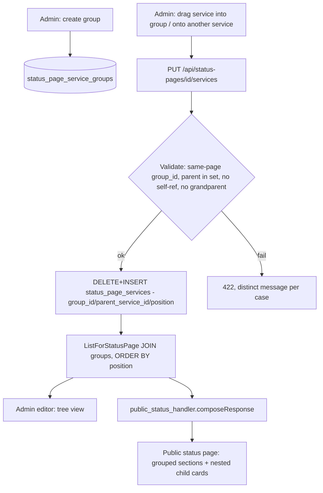

# Service Groups and Dependencies Design

**Spec**: `.specs/features/service-groups-and-dependencies/spec.md`
**Status**: Approved

---

## Architecture Overview

A new table `status_page_service_groups` holds named, ordered groups scoped to one `status_page_id`. `status_page_services` (today a flat `(status_page_id, service_id)` join) gains three additive columns: `group_id` (nullable FK), `parent_service_id` (nullable FK to `services(id)`), `position` (int). Both relations stay optional and independent — a service row can have neither, either, or both.

The existing `SetServices` full-replace write pattern (`DELETE` all rows for the page, re-`INSERT` the full set, same transaction) is preserved and extended: the request payload changes from `service_ids: string[]` to `services: {service_id, group_id, parent_service_id, position}[]`, validated server-side before the replace commits. Groups are a separate, first-class CRUD resource (`POST`/`PATCH`/`DELETE /api/status-pages/{id}/groups[/{groupId}]`) because a group must exist (and have an id) before a service placement can reference it — group lifecycle is independent of any single `SetServices` call.

`ListForStatusPage` (`internal/db/service_repository.go`) gains the three new `status_page_services` columns to its `SELECT`/JOIN and switches its `ORDER BY` from `s.name` to `position`. The public status handler (`internal/api/public_status_handler.go`) composes group metadata into each service entry and a new top-level `groups` array; the admin status-page detail/editor UI renders a draggable two-level tree (group → service, service → child) using `@dnd-kit` — the first drag-and-drop dependency in the codebase.



---

## Code Reuse Analysis

### Existing Components to Leverage

| Component | Location | How to Use |
| --------- | -------- | ---------- |
| `StatusPageRepository.SetServices` replace-all pattern | `internal/db/status_page_repository.go:138-171` | Same transaction shape (`DELETE` then loop-`INSERT`), extended to carry `group_id`/`parent_service_id`/`position` per row instead of just `service_id`. |
| `StatusPageRepository.Delete`'s manual child-cleanup | `internal/db/status_page_repository.go:360-384` | Same convention (no `ON DELETE CASCADE` in this schema) — deleting a status page must also manually `DELETE FROM status_page_service_groups WHERE status_page_id = $1` in the same transaction. |
| `ServiceRepository.ListForStatusPage` | `internal/db/service_repository.go:269-296` | Extended additively: JOIN adds `sps.group_id, sps.parent_service_id, sps.position`, plus a JOIN to `status_page_service_groups` for the group name; `ORDER BY s.name` becomes `ORDER BY g.position NULLS LAST, sps.position`. |
| `statusPageCreatorLister` interface | `internal/api/status_pages_handler.go:36-44` | Gains new methods for group CRUD + the richer `SetServices` signature. |
| Router registration pattern (linear chi routes) | `internal/cli/routes.go:281-300` | New `/groups` routes added in the same linear block, same `writeRoles`/`anyRole` gating as the existing `/services` route. |
| `mapDomainVerificationResult`-style distinct-422-messages convention | `internal/api/domains_handler.go` (pattern, not code reuse) | Same pattern applied to the 4 new validation failure cases (cross-page group, parent not in set, self-reference, grandparent depth). |
| `Drawer`, `Field`, `Button`, `Tag` UI primitives | `web/src/components/ui/` | Reused for the new group-management UI (create/rename group) and tree rows, same as `AttachDomainDrawer`/`EditStatusPageDrawer` already do. |
| MSW in-memory state + handler mirroring pattern | `web/src/test/msw/handlers.ts:1145-1284` | New `statusPageGroupsState` array + `http.get/post/patch/delete("/api/status-pages/:id/groups...")` handlers mirroring the new Go handler 1:1, same convention as every other MSW block in the file. |

### Integration Points

| System | Integration Method |
| ------ | ------------------- |
| New migration | `internal/db/migrations/0046_status_page_service_groups.up.sql`/`.down.sql` — creates `status_page_service_groups`, adds `group_id`/`parent_service_id`/`position` to `status_page_services`. Next sequential number after `0045`. |
| `internal/db/status_page_repository.go` | New `StatusPageServiceGroup` struct + `CreateGroup`/`UpdateGroup`/`DeleteGroup`/`ListGroups` methods (new file `internal/db/status_page_service_group_repository.go` or appended here — Tasks phase decides exact file split). `SetServices` signature changes to accept `[]ServicePlacement{ServiceID, GroupID *string, ParentServiceID *string, Position int}`, with the 4 validation rules enforced before the transaction's `DELETE`/`INSERT`. |
| `internal/api/status_pages_handler.go` | New `CreateGroup`/`UpdateGroup`/`DeleteGroup` handlers (new file `internal/api/status_page_groups_handler.go` or appended — Tasks decides). `SetServices` request struct changes to `{Services []servicePlacementRequest}`; `setStatusPageServicesRequest`/`setServicesRequest` renamed accordingly. `toStatusPageResponse` unaffected (service placement detail isn't part of the admin `StatusPage` list/detail response shape — `ServiceIDs []string` stays as a cheap existence-check field; full placement detail is a separate read, see below). |
| New read endpoint | `GET /api/status-pages/{id}/services` returns the full placement detail (`service_id, group_id, parent_service_id, position`) plus `GET /api/status-pages/{id}/groups` for the group list — the admin editor needs both to render the tree; neither is on the existing `GET /api/status-pages/{id}` response, keeping that endpoint's shape stable for every other consumer (list page, detail drawer). |
| `internal/cli/routes.go` | New lines in the existing linear block: `POST/PATCH/DELETE /api/status-pages/{id}/groups[/{groupId}]` (`writeRoles`), `GET /api/status-pages/{id}/groups` + `GET /api/status-pages/{id}/services` (`anyRole`) — same gating convention as the existing `/services` PATCH route. |
| `internal/api/public_status_handler.go` | `publicServiceResponse` gains `ID, GroupID *string, GroupName *string, ParentServiceID *string, ParentServiceName *string` (all additive, `omitempty` where nullable). `publicStatusResponse` gains `Groups []publicGroupResponse{ID, Name, Position}`. `composeResponse` loads groups once per request (new repository call) alongside the existing `ListForStatusPage` call — no N+1, one extra query. |
| `web/src/types/api.ts` | `StatusPageServiceGroup` type added; `Service`/public types gain the new optional fields, matching the Go response additively. |
| `web/src/features/status-pages/hooks.ts` | `useSetStatusPageServices`'s `SetStatusPageServicesInput.service_ids: string[]` becomes `services: ServicePlacement[]`; new `useStatusPageGroups`/`useCreateGroup`/`useUpdateGroup`/`useDeleteGroup`/`useStatusPageServicePlacements` hooks. |
| `web/src/features/status-pages/StatusPageEditorContent.tsx` | The checkbox-list `ServiceGroup`/`ServiceRow` pair (lines 408-473, purely local/visual, unrelated to the new domain concept) is replaced by a new `ServiceGroupPanel` tree component built on `@dnd-kit/core`+`@dnd-kit/sortable`. The "Linked"/"Available" two-list split stays (still need a way to attach/detach a service from the page at all) — the tree view applies only to the "Linked" side, organizing what's already attached. |
| `web/src/features/public-status/PublicStatusPage.tsx` | `data.services.map(...)` (lines 382-429) becomes: group services by `group_id` client-side (including a synthetic "ungrouped" bucket), render one `<section>` per group (including empty-state groups with zero services — an operator who created a group intentionally still sees it) wrapping the existing per-service `<Card>` unchanged, with a child service's card rendered indented directly under its parent's card wherever `parent_service_id` is set. React key changes from `service.name` to `service.id` (fixes the latent duplicate-name key bug as a side effect). |
| `web/src/test/msw/handlers.ts` | New `statusPageGroupsState`/`statusPagePlacementsState` in-memory arrays + handler block mirroring the new Go validation (404/422 cases) 1:1, same convention as the existing `status-pages` block. |
| New dependency | `@dnd-kit/core` + `@dnd-kit/sortable` added to `web/package.json` — first drag-and-drop library in this codebase. Keyboard-operable by default (accessibility requirement, not optional) — `@dnd-kit` ships keyboard sensor support out of the box, Tasks must wire it, not just pointer/mouse. |

---

## Components

### `StatusPageServiceGroupRepository` (or methods on `StatusPageRepository`)

- **Purpose**: CRUD for groups scoped to a status page.
- **Location**: `internal/db/status_page_repository.go` (extended) or new `internal/db/status_page_service_group_repository.go` — Tasks phase picks based on resulting file size.
- **Interfaces**:
  - `CreateGroup(ctx, statusPageID, name string) (*StatusPageServiceGroup, error)` — `position` assigned as `COUNT(*)` of existing groups for the page (append to end).
  - `UpdateGroup(ctx, id, name string, position int) (*StatusPageServiceGroup, error)` — rename and/or reposition.
  - `DeleteGroup(ctx, id string) error` — deletes the group row; relies on `status_page_services.group_id` being set `NULL` for its former members in the same transaction (no DB-level cascade, matches the schema's existing manual-cleanup convention).
  - `ListGroups(ctx, statusPageID string) ([]StatusPageServiceGroup, error)` — ordered by `position`.
- **Dependencies**: `*Pool`/tx, same as every other repository in the package.
- **Reuses**: transaction/error-handling conventions from `StatusPageRepository`.

### `apexServicePlacementValidator` (plain function, not a new interface — matches the codebase's preference for small pure functions over interfaces where no fake-injection is needed)

- **Purpose**: Validates a `[]ServicePlacement` payload before `SetServices` commits: every `group_id` belongs to the target status page, every `parent_service_id` is present in the same payload's `service_id` set, no self-reference, no service that already has a `parent_service_id` is itself referenced as a `parent_service_id`.
- **Location**: `internal/db/status_page_repository.go` (private function, called from `SetServices` before the transaction's `DELETE`).
- **Interfaces**: `validateServicePlacements(placements []ServicePlacement, validGroupIDs map[string]bool) error` — returns one of 4 distinct sentinel errors, mapped to 422 messages in the handler (same pattern as `mapDomainVerificationResult`).
- **Dependencies**: none external — pure validation over the payload plus a pre-fetched set of this page's valid group ids.
- **Reuses**: sentinel-error + handler-side mapping pattern from `internal/api/domains_handler.go`.

### `ServiceGroupPanel` (frontend)

- **Purpose**: Renders the admin editor's "Linked" services as a draggable 2-level tree (group → service, service → child) and persists layout changes via the richer `SetServices` call.
- **Location**: `web/src/features/status-pages/ServiceGroupPanel.tsx` (new).
- **Interfaces**: `<ServiceGroupPanel statusPageId={id} services={...} groups={...} onSave={...} />` — internal `@dnd-kit` `DndContext`/`SortableContext` wiring, keyboard sensor included.
- **Dependencies**: `@dnd-kit/core`, `@dnd-kit/sortable`.
- **Reuses**: `Field`, `Button`, `Tag` primitives from `web/src/components/ui/`; "Linked"/"Available" split stays from the existing `StatusPageEditorContent.tsx`.

---

## Data Models

### `StatusPageServiceGroup` (Go) / `StatusPageServiceGroup` (TS)

```go
type StatusPageServiceGroup struct {
    ID           string
    StatusPageID string
    Name         string
    Position     int
    CreatedAt    time.Time
}
```

**Relationships**: belongs to one `status_pages` row; referenced by zero or more `status_page_services.group_id`.

### `status_page_services` (extended, not a new Go struct — fields added to the existing placement concept)

```sql
ALTER TABLE status_page_services
    ADD COLUMN group_id          UUID REFERENCES status_page_service_groups(id) ON DELETE SET NULL,
    ADD COLUMN parent_service_id UUID REFERENCES services(id) ON DELETE SET NULL,
    ADD COLUMN position          INT NOT NULL DEFAULT 0;
```

```go
type ServicePlacement struct {
    ServiceID       string
    GroupID         *string
    ParentServiceID *string
    Position        int
}
```

**Relationships**: `group_id` → `status_page_service_groups.id` (nullable); `parent_service_id` → `services.id` (nullable, must be another service placed on the same page, enforced in Go not SQL).

---

## Error Handling Strategy

| Error Scenario | Handling | User Impact |
| --------------- | -------- | ------------ |
| `group_id` in payload belongs to a different status page | `validateServicePlacements` returns `ErrGroupCrossPage`, handler maps to 422 `"group does not belong to this status page"` | Admin UI shows inline error, layout not saved |
| `parent_service_id` not present in the same payload's service set | `ErrParentNotInSet` → 422 `"parent service is not attached to this status page"` | Same |
| `parent_service_id` equals the service's own `service_id` | `ErrSelfReference` → 422 `"a service cannot depend on itself"` | Same |
| A service with its own `parent_service_id` set is referenced as another service's `parent_service_id` (grandparent) | `ErrMaxDepthExceeded` → 422 `"a service that already has a parent cannot itself be a parent"` | Same |
| Group deleted while a service is assigned to it | `ON DELETE SET NULL` at the DB level — no error, service becomes ungrouped on next read | None — silent, correct fallback, matches spec Goal |
| Parent service removed from the page, or deleted entirely | `ON DELETE SET NULL` on `parent_service_id` — no error, child becomes parentless on next read | None — silent, correct fallback |
| Concurrent edits to the same status page's layout (two admins saving at once) | Last-write-wins, same as today's `SetServices` — no new concurrency control introduced | Later save overwrites earlier one, unchanged from today's behavior |

---

## Tech Decisions (only non-obvious ones)

| Decision | Choice | Rationale |
| -------- | ------ | --------- |
| Public API shape for groups | Flat `services: []` with `group_id`/`group_name` per entry, plus a top-level `groups: []` for names/order/empty-group display; not nested `groups[].services[]` | Smaller diff to the existing flat contract, frontend groups client-side once, and keeps `services: []`'s existing consumers (if any external) working for ungrouped-only cases. |
| `position` semantics | Plain int, full-replace on every `SetServices` call (position = array index in the submitted payload) | Matches the already-established full-replace write pattern — no incremental reorder endpoint, no fractional/sparse position scheme needed since the whole set is rewritten every save. |
| Parent-depth validation location | Go (`validateServicePlacements`), not a Postgres `CHECK`/trigger | Postgres can't easily `CHECK` against sibling rows in the same table; validating in Go before the transaction commits is simpler and matches how this codebase already handles cross-row invariants (e.g. domain verification). |
| New table vs. extending `status_page_services` only | New `status_page_service_groups` table for groups, `group_id` FK on `status_page_services` | A group needs its own identity (id, name, position) independent of any one service — can't be modeled as a column on the join table alone. |
| Drag-and-drop library | `@dnd-kit/core` + `@dnd-kit/sortable` | User's explicit choice over a zero-dependency button-based reorder UI; `@dnd-kit` is the actively maintained modern standard (unlike `react-beautiful-dnd`) and ships keyboard-sensor accessibility support, which Tasks must wire in, not treat as optional. |
| Cascade convention | Manual cleanup in Go (same transaction), `ON DELETE SET NULL` for the two optional FKs, no `ON DELETE CASCADE` anywhere new | Matches this schema's existing convention (`status_page_services` has no cascade from `status_pages` either) — introducing cascade here while the rest of the schema doesn't use it would be an inconsistent, undiscussed schema-wide change. |
| Admin read surface for placement detail | Two new `GET` endpoints (`/groups`, `/services` detail) rather than growing `GET /api/status-pages/{id}`'s existing response | Keeps the existing `StatusPage`/`statusPageResponse` shape (used by the list page and other consumers) stable; placement detail is only needed by the one editor screen. |

---

## Amendments

(none yet — this section exists for updates made during Execute, matching `domain-apex-txt-verification/design.md`'s convention)
